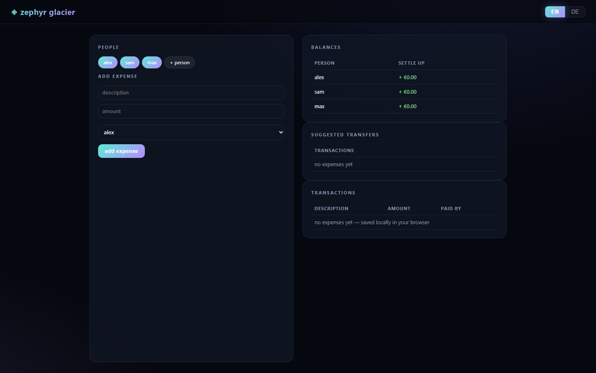
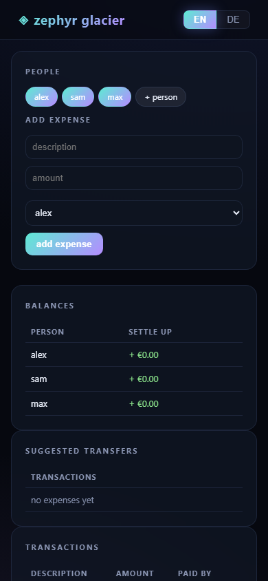

# Zephyr Glacier — Splitwise Local

A local-first expense splitter built with Vue 3: shared expenses, per-person balances, greedy settle-up suggestions and browser persistence. No account, no server.

<div align="center">


**[Live Demo](https://ruslanfridenli.github.io/zephyr-glacier/)** · **[Deutsch ↓](#-deutsch)**

</div>

---

## Screenshots






## Features

- Vue 3 composition-free reactive app
- Shared expense tracking with split logic
- Automatic settle-up transfer suggestions
- Per-person balance table
- localStorage persistence
- English/German interface

## Local development

```bash
git clone https://github.com/ruslanfridenli/zephyr-glacier.git
cd zephyr-glacier
# open index.html in a browser, or serve statically:
npx serve .
```

No build step, no dependencies — pure static site.

---

## 🇩🇪 Deutsch

### Zephyr Glacier — Splitwise Local

Ein local-first Kosten-Splitter mit Vue 3: geteilte Ausgaben, Salden pro Person, automatisierte Abrechnungsvorschläge und Speicherung im Browser. Kein Account, kein Server.

### Funktionen

- Reaktive Vue-3-App
- Geteilte Ausgaben mit Split-Logik
- Automatische Abrechnungsvorschläge
- Salden-Tabelle pro Person
- localStorage-Persistenz
- Englische/deutsche Oberfläche

### Lokale Entwicklung

```bash
git clone https://github.com/ruslanfridenli/zephyr-glacier.git
cd zephyr-glacier
npx serve .
```

Reine statische Seite — kein Build-Schritt, keine Abhängigkeiten.

---

## ☕ Support / Unterstützen

Wenn dir diese Website beim Lernen hilft, würde mir eine Spende sehr viel bedeuten und dabei helfen, sie weiterzuentwickeln. Alternativ kannst du das Projekt mit einem Stern im github repo unterstützen. Vielen Dank!

- Solana: `zQpgZ6nGigww7vYpz3Qqxb1BT44kqS567vFaLTeHagS`
- Ethereum: `0x9c4fE1B2e9a1A9c22312c8296BB088Ca0e8F1B4e`
- Bitcoin: `bc1p2jltk9ya9kyzv35d8kxn7mmg9jqkx66cqtgzqwe75zlr4v9jk4hsv468q7`

---

Made with care. Feedback welcome via issues.
